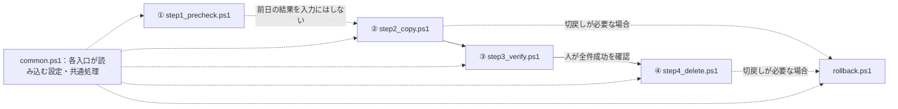

# 診断設定移行スクリプトの読み方・作業の進め方

2026年11月19日（日本時間）時点の説明用下書きです。**完成版のレビュー依頼・本番実行の案内は、現行版の実機確認が終わってから行います。**
現行6本はLinux PowerShell 7.5.4で136ケース・1,162判定を確認済みです。1,095日のテーブルAPI単独確認と、その試験資産の撤去も完了しています。現行版のWindows PowerShell 5.1実行、Azureでの主要工程・中断・再開・切戻しは未完了です。
旧版のWindows 889判定・Azure 74実行・350診断設定の検証は履歴です。現行版の実績としては数えません。最後の54タイプの網羅・負荷テストは、主要6本の完成とユーザーレビュー後に実施します。

本文では、サブスクリプションを「Sub」、リソースグループを「RG」と略します。

## 1. この処理で何を移すのか

「既存のログの収集条件を保ち、新しい送信設定を追加し、確認後に旧送信設定を外す」処理です。保存済みログをコピーする処理ではありません。

| 名前 | 意味・このスクリプトでの扱い |
|---|---|
| 移行元ワークスペース | 旧診断設定の宛先。このIDを持つ設定だけを選びます。変数名は `$targetWorkspaceId` ですが、指定するのは**移行元**です。 |
| 新しい保存先 | CSVで指定するStorageまたはLog Analytics。新しい診断設定の宛先になります。 |
| 診断設定 | 各Azureリソースに付く「何のログ・メトリックをどこへ送るか」という設定です。旧設定を残して新設定を追加します。 |
| DCR | VM・VMSSから収集する内容と送信先の定義です。新DCRは原本どおりWindowsのApplication/Security/SystemとSyslogを収集します。 |
| DCR関連付け | VM・VMSSとDCRを結ぶ別の設定です。指定した旧DCR 2本に関連する個体だけが新関連の対象です。 |
| 適用除外 | 作業前に各Subへ置く3件のWaiverです。最初の2件は割り当て全体、3件目だけ指定12参照IDを除外します。 |

診断設定の対象判定とDCR関連の対象判定は別です。「旧診断だけあるVM」と「旧DCR関連だけあるVMSS」も、それぞれ該当する処理だけを受けます。指定外の診断設定・DCR関連は対象にしません。

## 2. 6ファイルの関係



| ファイル | 上から読むときの順序 |
|---|---|
| [common.ps1](migration/common.ps1) | 利用者設定 → 通信 → 対象探索 → 比較・結果記録 → DCR完成形 → バックアップ検査。単独では実行しません。 |
| [step1_precheck.ps1](migration/step1_precheck.ps1) | CSV読込み → Subごとのポリシー確認 → 対象・名前・追加可能数の確認 → 結果CSV。 |
| [step2_copy.ps1](migration/step2_copy.ps1) | CSV基本確認 → Subごとの再調査・変更前保存 → 適用除外 → 保存先/DCR準備 → 新診断設定の追加。 |
| [step3_verify.ps1](migration/step3_verify.ps1) | ②の記録とCSV確認 → 現在の対象を再調査 → 保存先・関連・新診断設定の全件照合。Azureへの書込みはありません。 |
| [step4_delete.ps1](migration/step4_delete.ps1) | 全CSV対象の再確認 → 全対象の旧DCR関連解除 → 旧診断設定削除。 |
| [rollback.ps1](migration/rollback.ps1) | 全体/指定Subの確認 → 旧関連復元 → 旧診断設定復元 → 読戻し確認 → 今回の新側設定を元へ戻す。 |

通信・探索・比較は複数の工程で同じ動作が必要なため共通化しています。保存先を作る処理は②、確認だけは③・④、切戻し専用処理はrollbackに置き、各工程で実施する内容を追えるようにしています。

## 3. 実行前に指定する値

[common.ps1冒頭](migration/common.ps1#L3)で、通常は次の2項目を指定します。

```powershell
# 説明用の値です。対象環境の実際の移行元IDへ置き換えます。
$targetWorkspaceId = "/subscriptions/00000000-0000-0000-0000-000000000000/resourceGroups/rg-old/providers/Microsoft.OperationalInsights/workspaces/log-old"
$environment = "dev" # prod / stg / dev
```

旧DCRは `$oldDcrIdsByEnvironment` に提示済みの環境別2本が設定されています。選んだ環境の値を確認してください。新診断設定の共通名を変える場合は、同ファイルの `$newDiagnosticSettingName` を変更します。実行途中でこれらの値は変えません。
[CSV入力例](migration/log_migration_targets_regional.example.csv)を同じフォルダーへ `log_migration_targets_regional.csv` として保存します。1Subにつき1行、今回の環境のSubだけを記載します。

| CSV列 | 指定するもの |
|---|---|
| SubscriptionName | 対象SubのID。一意の名前も使えますが、IDなら名前変更や同名を避けられます。 |
| ResourceGroup | 新しい保存先を用意するRG。移行対象リソースの所属RGを指定する列ではありません。 |
| StorageAccount | 小文字英数字3〜24文字、`jpe`をちょうど1箇所含む名前。Log行は空欄可。 |
| WorkspaceName | **新しい**Log Analytics名。Storage行でもVMログ用の保存先として準備します。 |
| LogDestination | `Storage` または `Log`。 |

```csv
SubscriptionName,ResourceGroup,StorageAccount,WorkspaceName,LogDestination
11111111-1111-1111-1111-111111111111,rg-log-new-a,stexamplejpe01,log-new-a,Storage
22222222-2222-2222-2222-222222222222,rg-log-new-b,,log-new-b,Log
```

Storageは対象リソースの実リージョン分だけ用意します。`jpe`部分だけをMicrosoft公開のAzure Naming Toolの略称に置換し、変換後の長さ・重複・利用可否も確認します。global/所在地なしは東日本です。Log行はリージョン別Storageを作りません。

## 4. 各工程で止まる位置・変更する位置

### ①は前日にも使える独立した確認

[①の本体](migration/step1_precheck.ps1#L4)は、環境のポリシー割り当て・参照ID、現在の対象、新設定名、Storage名とStandard_ZRSの利用可否、診断設定の追加枠などを確認します。同名の新診断設定・Storageは初回事前チェックで停止します。
Azureを変更せず、Beforeバックアップも作りません。既存の②バックアップも読み書きしません。前日の①が成功しても、当日の②は自分で現在値を調べ直します。

### ②はSubごとに「調査→保存→変更」

[②のSubループ](migration/step2_copy.ps1#L46)を1周ずつ読むと順序を追えます。

1. 現在の旧診断設定・旧DCR関連・リージョンを調査し、初回の同名衝突を確認します。
2. 切戻しに必要な情報をVersion 3のJSONへ保存します。一時ファイルに完全に書いてから差し替え、保存できないSubへの書込みは始めません。
3. 3件のWaiverを確認・作成し、必要なプロバイダーを登録します。
4. RG、リージョン別Storage、新ワークスペースを準備します。旧DCR対象があればEvent/Syslog、新DCR、新関連も準備します。
5. 準備が成功したSubだけ、新診断設定を追加して読み戻します。旧診断設定・旧DCR関連は残します。

Subは順番に処理します。あるSubの準備に失敗しても他Subの処理は続く場合があり、最後に未完了一覧を出してエラー終了します。各Subの変更前保存は、そのSubの最初の変更より前です。
保存済みBeforeは再実行でも上書きしません。新しく見つかった対象だけ追記します。保存済みの旧設定が消えた・内容が変わった場合は、古いBeforeのまま作業を進めず停止します。
今回の記録にある新設定は完成形と一致すればスキップします。初めて扱う対象にある同名設定は再利用しません。保存先の不変の基礎構成が違う場合も上書きせず、手動対応へ回します。

### ③は手動修正後にも使う全件確認

[③](migration/step3_verify.ps1#L20)は、現在のAzureと②の記録の両方を読みます。旧設定が既に削除済みでも、記録した全対象の新設定を確認します。記録外の旧対象の追加や設定変更は停止理由になります。
保存先だけでなく、新診断の収集条件・宛先、新DCR・関連、保持設定、Waiverまで確認します。結果をCSVへ出すだけで、Azureは変更しません。

### ④は全CSV対象の確認が通るまで削除しない

[④の前半](migration/step4_delete.ps1#L20)は③に相当する確認です。実行時CSVの全Subを確認し、1件でも未完了なら最初のDELETEも行いません。
確認後は、**全対象の旧DCR 2本への関連を解除してから、旧診断設定を削除**します。旧DCR本体は削除しません。削除直前も新旧設定を照合し、最初の削除失敗で以後の削除を止めます。
④を途中から再実行する場合も全件確認をやり直し、既にない旧設定を除いて残りを処理します。

## 5. Beforeバックアップと結果CSVは別のもの

②が作る `migration/log_migration_backup_<環境名>.json` が、③・④・rollbackで使う復元情報です。①の結果CSVからは作りません。

| JSON内の情報 | 何のために保存するか |
|---|---|
| 環境・移行元・新設定名・CSVの保存先指定 | 別の移行や異なる宛先の記録を誤って使わないため。 |
| DiagnosticsのBefore / After | 旧診断設定を戻す内容と、新診断設定の完成形を区別するため。 |
| 新DCR・新関連のBefore / After | 同じIDに以前から設定があった場合、切戻しで元の内容へ戻すため。 |
| OldAssociationsのBefore | 指定した旧2DCRへの関連を、説明なども含めて復元するため。 |
| StorageのID・名前・region、Waiverの既存有無 | 保存先を取り違えず、既存の適用除外を残すため。 |

対象の設定情報だけを保存し、保存済みログデータや全Azure資源のバックアップは取りません。旧診断の取得結果を再利用し、旧DCR関連だけは一覧で省略される項目を個別GETします。
Beforeの `null` は「そのIDに変更前の設定がなかった」ことを表します。
中身を読むだけなら、Windows PowerShellで次のように確認できます。作業途中にJSONを編集・削除して再作成しないでください。

```powershell
$backup = Get-Content '.\migration\log_migration_backup_dev.json' -Raw -Encoding UTF8 | ConvertFrom-Json
$backup.Targets[0].Diagnostics | Select-Object ResourceId, OldName, Before, After
```

`*_results.csv` はOK/NGの確認一覧、`*_failures.csv` は未完了の一覧です。**どちらも後工程の入力ではありません。** ②のJSONだけが変更前情報・処理記録の入力です。
手動対応では `ResourceId` と `Stage` で場所を探し、`Reason` で理由、`ExpectedLogs`・`ExpectedMetrics`・`ExpectedConfiguration` で期待する設定を確認します。手動修正後は③を再実行します。

## 6. 3年保持で変更する2つの設定

| 保存先の設定 | 今回の値 | 他の設定の扱い |
|---|---|---|
| StorageのLifecycle | `log-append-1095`：appendBlobの最終更新から1,095日超で削除対象にする。 | 管理対象の旧`log-append-365`を置換。別名のルールは保持。 |
| Event / Syslogテーブル | `totalRetentionInDays = 1095`をテーブル単位で明示設定。 | 既存テーブルはこの1項目だけPATCHし、分析保持期間・スキーマ・プランは維持。 |
| ワークスペース既定値 | `retentionInDays = 365`のまま。 | Event/Syslog以外のテーブルを一律1,095日にはしない。 |

テーブルの**合計1,095日には分析保持期間も含みます**。「分析期間＋さらに1,095日」ではありません。診断設定のログ・メトリック収集条件は旧設定を引き継ぎ、上記の保存先設定で保持期間を扱います。
実装は [②Storageルール](migration/step2_copy.ps1#L294)、[②Workspace](migration/step2_copy.ps1#L336)、[②Event/Syslog](migration/step2_copy.ps1#L372)。③・④は値の一致を確認するだけです。
AzureのAPI単独確認では、EventへのPUTと既存SyslogへのPATCHで合計1,095日を設定できることを確認しました。SyslogのPATCHでは分析保持30日・スキーマ・プランを維持し、Workspace既定値も365日のままでした。Eventは既存の組込テーブルとして応答しており、未存在テーブルの新規作成を確認した結果ではありません。①〜切戻しの通し確認とは別です。

## 7. 操作者の進め方と途中停止時の選択

Windows PowerShell 5.1とAzure CLIを用意し、Ownerとして`az login`済みの状態で、リポジトリの最上位から**工程ごとに1つずつ**実行します。

| タイミング | 実行・確認すること |
|---|---|
| 前日など | `powershell.exe -NoProfile -File .\migration\step1_precheck.ps1`。NGを解消する。 |
| 作業当日 | `powershell.exe -NoProfile -File .\migration\step2_copy.ps1`。Before保存とコピー結果を確認。 |
| 未完了がある場合 | failuresの期待値を見て手動修正するか、同じ②を再実行。旧設定はまだ残っている。 |
| 設定完了確認 | `powershell.exe -NoProfile -File .\migration\step3_verify.ps1`。全行OKを確認。 |
| 削除へ進む判断 | 人が③の全件成功と作業対象を確認する。 |
| 旧設定を外す | `powershell.exe -NoProfile -File .\migration\step4_delete.ps1`。削除結果を確認。 |

| 止まった工程 | 続ける場合 | 元の送信経路へ戻す場合 |
|---|---|---|
| ① | 問題を修正して①を再実行。Azure変更はない。 | 切戻し不要。 |
| ②途中・完了後 | 同じ変数・CSV・JSONを保持して②。次に③。①を再開用に使わない。 | ②のJSONを指定してrollback。 |
| ④途中・完了後 | 同じ記録で③、全件確認後に④。旧設定の削除済みを考慮して再確認する。 | 同じrollbackで旧診断・旧DCR関連を復元。 |

再開のために保存先や新設定名を変えません。対象を明示的に絞る場合はCSVの行を減らせますが、保存済みの各行の値は維持します。切戻しの対象選択はCSVではなく、次の引数で指定します。
引数なしは**②のJSONにある全Sub**を戻します。以下は選択肢であり、順番に両方実行する手順ではありません。

```powershell
# 全体を切り戻す場合
.\migration\rollback.ps1
# 指定Subだけを戻す場合。複数IDは配列で渡します。
.\migration\rollback.ps1 -SubscriptionIds '11111111-1111-1111-1111-111111111111', '22222222-2222-2222-2222-222222222222'
```

切戻しの基準は**各対象を②で最初に変更する直前**です。①は確認だけなので①実行時のスナップショットへ戻す処理ではありません。
[rollbackの復元順](migration/rollback.ps1#L91)は旧DCR関連の全件復元・読戻し→旧診断設定復元・読戻し→新側の後片付けです。復元失敗時は新診断設定を残して停止し、同名の異なる設定を上書き・削除しません。
Storage・Log Analytics・保存済みログ・新規DCR本体は残します。保存先の保持設定も切戻し対象ではありません。以前からあった新側DCR/関連はBeforeへ戻し、今回追加した関連と新診断を外します。既存Waiverは保持し、今回新設したWaiverだけを明示的な切戻し時に削除します。通常の①〜④ではWaiverを自動削除しません。

## 8. PowerShellを読むための最小限の見方

| 書き方 | 読み方 |
|---|---|
| `$target` / `$target.SubscriptionId` | 値を入れる名前 / その中のSub ID。 |
| `@(...)` / `@{ ... }` | 複数の値を並べる配列 / 項目名と値を組にする表。 |
| `foreach` | 対象を1件ずつ取り出して同じ処理をする。 |
| `Where-Object` / `-eq` / `-not` | 条件に合うものを選ぶ / 等しい / 条件を反転する。 |
| `try` / `catch` | 処理を試す / エラーになったときの処理。 |
| `continue` / `throw` | 今の1件を終えて次へ / エラーとして処理を止める。catchがあればそこで記録する。 |
| `$null = ...` / 行末のバッククォート | 戻り値を画面へ出さない / 次の行も同じ命令の続き。 |

次は読解用の実コード抜粋です。[②の新対象追加](migration/step2_copy.ps1#L83)では、既に記録がある対象を飛ばし、初めての対象に同名新設定があれば止めます。

```powershell
foreach ($plan in $target.DiagnosticPlans) {
    if (@($snapshot.Diagnostics | Where-Object ResourceId -eq $plan.ResourceId).Count -gt 0) { continue }
    if (@($plan.NewSettings).Count -gt 0) { throw "新しい診断設定名が既存設定と重複しています: $($plan.ResourceId)" }
    # この後の変更前情報の追加処理は、抜粋では省略しています。
}
```

[②のBlob設定](migration/step2_copy.ps1#L284)の次の表は「propertiesの中のisVersioningEnabledをtrueにする」という期待値です。`@{}`は項目名で値を取り出せる表、`@()`は順番に取り出せる複数値、と読み分けます。

```powershell
$expected = @{ properties = @{ isVersioningEnabled = $true } }
```

[③の調査](migration/step3_verify.ps1#L29)は、失敗をcatchで一覧へ記録します。`throw`があっても、どこでcatchしているかを追うと「そのSubを中断するのか、工程全体を終了するのか」が分かります。

```powershell
try { $null = Get-MigrationPlan -Target $target }
catch { Add-MigrationFailure -Target $target -Stage '全件調査' -Message $_.Exception.Message }
```

Sub全体を並列にはしていません。[共通のバッチ処理](migration/common.ps1#L193)が診断設定の調査・複製などを最大5標準ジョブに分けます。削除は順番に行い、失敗した後の削除を止めます。現行版の実所要時間は実機検証後に示し、旧版の時間を100Subの所要時間へそのまま換算しません。

## 9. 要件とコード・テストの対応

下表は現在のオフライン試験です。Azure実機での成功を表す表ではありません。集計は [regression-summary.json](tests/regression-summary.json)、現行コードの確認状況は [READABILITY_REFACTOR.md](test-results/READABILITY_REFACTOR.md) を参照します。

| 確認したい要件 | 読むコード | テストの例 |
|---|---|---|
| ①は独立・Before不要 | [①](migration/step1_precheck.ps1#L4) | [backup-rollback](tests/backup-rollback-smoke.ps1#L519)：既存の②backupを読まず確認。 |
| 各Subの変更前に保存・保存失敗なら書込み0 | [②保存](migration/step2_copy.ps1#L150) | [backup-rollback](tests/backup-rollback-smoke.ps1#L444)、[保存失敗](tests/backup-rollback-smoke.ps1#L786)。 |
| Before不変・再開・新対象追記 | [②再開](migration/step2_copy.ps1#L60) | [backup-rollback](tests/backup-rollback-smoke.ps1#L530)、[後日追加region](tests/regression.ps1#L711)。 |
| 初回衝突停止・自分の一致済み設定skip | [②名前](migration/step2_copy.ps1#L83)、[②複製](migration/step2_copy.ps1#L477) | [regression](tests/regression.ps1#L696)、[一致済み再実行](tests/baseline-smoke.ps1#L215)。 |
| 全件成功後に旧関連→旧診断を削除 | [④](migration/step4_delete.ps1#L184) | [後続Sub不備で全DELETE0](tests/backup-rollback-smoke.ps1#L821)、[旧2本だけ解除](tests/dcr-cutover-smoke.ps1#L380)。 |
| 復元を先に完了・指定外Sub保持 | [rollback](migration/rollback.ps1#L91) | [復元順序](tests/backup-rollback-smoke.ps1#L617)、[Sub選択](tests/backup-rollback-smoke.ps1#L645)。 |
| 1,095日・既存分析保持・別名ルール保持 | [②保持設定](migration/step2_copy.ps1#L294) | [総保持だけ補完](tests/baseline-smoke.ps1#L398)、[旧365ルール置換](tests/baseline-smoke.ps1#L520)。 |
| 最大5ジョブ・終了時に回収 | [共通バッチ](migration/common.ps1#L193) | [0/1件と上限5](tests/regression.ps1#L426)、[起動失敗](tests/regression.ps1#L489)。 |
