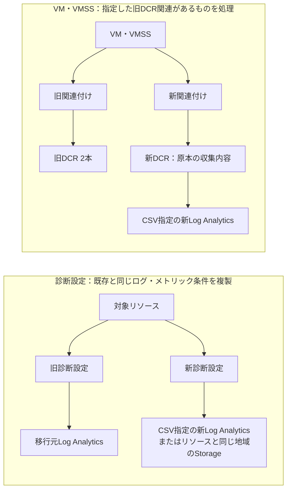
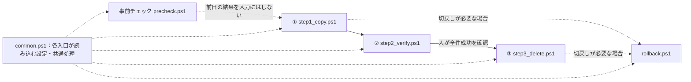

# 診断設定移行スクリプトの読み方・作業の進め方

2026年11月19日（日本時間）時点の、主要6本をレビューするための説明資料です。
送信先選択を追加した現行6本は、実Windows PowerShell 5.1.20348.5773 DesktopとLinux PowerShell 7.5.4で、それぞれ185ケース・1,845判定が成功しました。API／CLIの外部応答を再生する回帰試験です。[Windows個別結果](test-results/destination-selection-windows51.json)、[Linux結果](test-results/destination-selection-linux.json)、[全185ケース](test-results/CURRENT_FORMAL_CASES.md)を参照してください。
過去のAzure実機10条件・50工程は、送信先選択を追加する前の版の実績です。今回のフラグをAzureへ適用した実績には数えません。最後の54タイプの網羅・負荷テストは、主要6本のユーザーレビュー後に実施します。

コメントは区切り線付きで統一し、処理ブロックの役割と、関数の引数・戻り値・重要な条件を短く説明しています。

本文では、サブスクリプションを「Sub」、リソースグループを「RG」と略します。

## 1. この処理で何を移すのか

診断設定とVM・VMSSのログ送信を、それぞれ新しい保存先へ移すか、送信を終了するか選びます。移す側は新設定を追加してから、送信を終了する側は新設定を作らず、最後の③で旧設定を外します。保存済みログはコピーしません。

| 名前 | 意味・このスクリプトでの扱い |
|---|---|
| 移行元ワークスペース | 旧診断設定の宛先。このIDを持つ設定だけを選びます。変数名は `$targetWorkspaceId` ですが、指定するのは**移行元**です。 |
| 新しい保存先 | RGとLog Analyticsは全行で準備します。Storage名を指定した行は、送信の選択に関係なく地域別Storageも準備します。 |
| 診断設定 | 各Azureリソースに付く、ログ・メトリックの収集条件と送信先です。CSVの`LogDestination`で移行・終了を選びます。 |
| DCR | VM・VMSSの収集内容と送信先の定義です。`VmLogDestination=Log`ではWindowsのApplication/Security/SystemとSyslogを新Log Analyticsへ送ります。 |
| DCR関連付け | VM・VMSSとDCRを結ぶ別の設定です。指定した旧DCR 2本に関連する個体だけが新関連の対象です。 |
| 適用除外 | 作業前に各Subへ置く3件のWaiverです。最初の2件は割り当て全体、3件目だけ指定12参照IDを除外します。送信終了後の旧設定の再適用も防ぎます。 |

診断設定の対象判定とDCR関連の対象判定は別です。「旧診断だけあるVM」と「旧DCR関連だけあるVMSS」も、それぞれ該当する処理だけを受けます。指定外の診断設定・DCR関連は対象にしません。

次の図は、診断設定とVMログの両方で新設定を作る場合です。`None`・空欄の側は新経路を追加せず、③で旧経路だけを外します。診断とVMの片方だけ、または両方の送信を終了できます。



`VmLogDestination=Log`なら、VM・VMSS用の新DCRと新関連付け（DCRA）を用意します。両方を`None`・空欄にしても、保存先とWaiverは準備します。省略するのは新診断設定・新DCR・新DCRAだけです。旧VM・VMSS対象があれば、VMログを止める場合もEvent/Syslogの3年保持を準備します。

## 2. 6ファイルの関係



| ファイル | 上から読むときの順序 |
|---|---|
| [common.ps1](migration/common.ps1) | 利用者設定 → 通信 → 対象探索 → 比較・結果記録 → DCR完成形 → バックアップ検査。単独では実行しません。 |
| [precheck.ps1](migration/precheck.ps1) | CSV読込み → Subごとのポリシー確認 → 対象・名前・追加可能数の確認 → 結果CSV。 |
| [step1_copy.ps1](migration/step1_copy.ps1) | CSV確認 → Subごとの再調査・変更前保存 → 適用除外 → 保存先を準備 → 有効な側の新設定を準備。 |
| [step2_verify.ps1](migration/step2_verify.ps1) | ①の記録とCSV確認 → 現在の対象を再調査 → 保存先・保持設定と有効な側の新設定を照合し、省略側はOKを記録。Azureへの書込みはありません。 |
| [step3_delete.ps1](migration/step3_delete.ps1) | 全CSV対象の再確認 → 全対象の旧DCR関連解除 → 旧診断設定削除。 |
| [rollback.ps1](migration/rollback.ps1) | 全体/指定Subの確認 → 旧関連復元 → 旧診断設定復元 → 読戻し確認 → 今回の新側設定を元へ戻す。 |

通信・探索・比較は複数の工程で同じ動作が必要なため共通化しています。保存先を作る処理は①、確認だけは②・③、切戻し専用処理はrollbackに置き、各工程で実施する内容を追えるようにしています。

### commonの関数を使う場所

○はそのファイルから直接使用、△は別の共通関数を経由して使用、—は未使用です。19関数すべてが3〜5ファイルから使われ、事前チェック専用・切戻し専用の関数はcommonにはありません。

| 関数 | 主な用途 | precheck | copy | verify | delete | rollback |
|---|---|:---:|:---:|:---:|:---:|:---:|
| `Invoke-AzJson` | Azure CLIを呼びJSONを読む | ○ | ○ | ○ | ○ | △ |
| `Get-ArmToken` | ARM通信用のトークンを取得・再利用 | △ | △ | △ | △ | △ |
| `Invoke-ArmRequest` | ARM APIを呼ぶ | ○ | ○ | △ | ○ | ○ |
| `Invoke-DiagnosticBatch` | リソース処理を最大5ジョブで実行 | △ | ○ | △ | △ | ○ |
| `Get-DiagnosticSettings` | 診断設定を取得 | △ | ○ | △ | ○ | ○ |
| `Get-DiagnosticSignature` | 診断設定を比較できる形にする | △ | ○ | ○ | ○ | ○ |
| `Get-OptionalArmResource` | リソースを取得し、404だけを不存在として扱う | — | ○ | ○ | ○ | ○ |
| `Add-MigrationCheck` | 確認結果を記録 | ○ | ○ | ○ | ○ | △ |
| `Add-MigrationFailure` | 未完了と理由を記録 | ○ | ○ | ○ | ○ | ○ |
| `Complete-MigrationStep` | 結果CSVを出し、工程を終了 | ○ | ○ | ○ | ○ | ○ |
| `Get-MigrationTargets` | CSVとサブスクリプションを確認 | ○ | ○ | ○ | ○ | — |
| `Get-MigrationPlan` | 現在の旧設定・リージョン・対象を調査 | ○ | ○ | ○ | ○ | — |
| `Test-BaselineValues` | 現在値と期待値を比較 | — | ○ | ○ | ○ | ○ |
| `Assert-PolicyExemption` | Waiverの内容を照合 | — | ○ | ○ | ○ | ○ |
| `Get-MigrationDcrBody` | 新DCRの設定内容を組み立てる | — | ○ | ○ | ○ | — |
| `Get-RollbackBody` | DCR・関連付けの設定値を取り出す | △ | ○ | ○ | ○ | ○ |
| `Read-MigrationBackup` | 変更前情報を読み、取り違いを確認 | — | ○ | ○ | ○ | ○ |
| `Get-OldDcrAssociations` | 指定した旧2DCRの関連を取得 | △ | △ | △ | △ | — |
| `Assert-DcrCutoverIds` | 新旧DCR・関連のID重複を確認 | △ | △ | △ | △ | △ |

`Get-RollbackBody`は切戻し専用ではありません。コピー前の保存や、確認・削除時の比較にも同じ処理を使います。事前チェック時だけの同名診断設定の判定と、イニシアティブ取得結果の初期化は`precheck.ps1`に置いています。

### 共通関数から何が戻るのか

①を読む際は、次の値の受渡しを押さえると流れを追えます。

| 呼び出し | 戻る値・呼んだ後に使うもの |
|---|---|
| `$targets = @(Get-MigrationTargets)` | CSVの各行を、サブスクリプションIDなども含む対象の一覧として返します。 |
| `$planReady = Get-MigrationPlan -Target $target` | 戻る値は調査成否のtrue/falseです。調べた診断設定・保存先・旧関連は、渡した`$target`の中へ入ります。 |
| `Read-MigrationBackup` | 保存した変更前情報を読み、環境や対象が一致するか確認して、その情報を返します。 |
| `Invoke-DiagnosticBatch` | 各対象について`Item`（対象）、`Result`（結果）、`Error`（失敗理由）を返します。呼んだファイル側で結果を記録します。 |
| `Test-BaselineValues` | 現在値が期待値を満たすか、true/falseで返します。設定を変更する処理ではありません。 |
| `Get-RollbackBody` | DCR・関連付けの応答から、保存や比較に必要な設定値を取り出して返します。Azureには書き込みません。 |
| `Add-MigrationCheck` / `Add-MigrationFailure` | 結果を一覧へ追加します。工程の最後に`Complete-MigrationStep`がCSVへ出し、未完了があればエラーで終了します。 |

## 3. 実行前に指定する値

[common.ps1冒頭](migration/common.ps1#L7)で、通常は次の2項目を指定します。

```powershell
# 説明用の値です。対象環境の実際の移行元IDへ置き換えます。
$targetWorkspaceId = "/subscriptions/00000000-0000-0000-0000-000000000000/resourceGroups/rg-old/providers/Microsoft.OperationalInsights/workspaces/log-old"
$environment = "dev" # prod / stg / dev
```

旧DCRは `$oldDcrIdsByEnvironment` に提示済みの環境別2本が設定されています。選んだ環境の値を確認してください。新診断設定の共通名を変える場合は、同ファイルの `$newDiagnosticSettingName` を変更します。実行途中でこれらの値は変えません。
[CSV入力例](migration/log_migration_targets_regional.example.csv)を同じフォルダーへ `log_migration_targets_regional.csv` として保存します。1Subにつき1行、今回の環境のSubだけを記載します。

| CSV列 | 指定するもの |
|---|---|
| SubscriptionName | 対象SubのID。一意の名前も使えますが、IDなら名前変更や同名を避けられます。 |
| ResourceGroup | 全行で必須。保存先のRGで、移行対象リソースの所属RGではありません。 |
| StorageAccount | `LogDestination=Storage`は必須。他の選択では空欄可。名前があれば全モードでStorageを準備します。小文字英数字3〜24文字で、`jpe`をちょうど1箇所含めます。 |
| WorkspaceName | 全行で必須。新しいLog Analytics名。 |
| LogDestination | 診断設定の選択。`Storage`・`Log`は新設定を作成、`None`・空欄は③で旧設定を外して送信終了。 |
| VmLogDestination | VM・VMSSの選択。`Log`は新DCR・新DCRAを作成、`None`・空欄は③で旧関連を外して送信終了。 |

`VmLogDestination`列がない旧CSVは、VMログを`Log`として扱います。列を追加して空欄にすると送信終了の指定になるため、列の有無を確認してください。

| LogDestination | VmLogDestination | ③完了後の送信先 |
|---|---|---|
| Storage | Log | 診断はStorage、VMはLog Analytics。 |
| Storage | None / 空欄 | 診断だけをStorageへ送信。VMの送信は終了。 |
| Log | Log | 診断・VMともLog Analytics。 |
| Log | None / 空欄 | 診断だけをLog Analyticsへ送信。VMの送信は終了。 |
| None / 空欄 | Log | VMだけを新Log Analyticsへ送信。診断の送信は終了。 |
| None / 空欄 | None / 空欄 | 両方の送信を終了。保存先とWaiverは準備する。 |

```csv
SubscriptionName,ResourceGroup,StorageAccount,WorkspaceName,LogDestination,VmLogDestination
11111111-1111-1111-1111-111111111111,rg-log-new-a,stexamplejpe01,log-new-a,Storage,Log
22222222-2222-2222-2222-222222222222,rg-log-new-b,,log-new-b,Log,None
33333333-3333-3333-3333-333333333333,rg-log-new-c,,log-new-c,None,Log
44444444-4444-4444-4444-444444444444,rg-log-new-d,stexamplejpe04,log-new-d,Storage,
55555555-5555-5555-5555-555555555555,rg-log-new-e,stexamplejpe05,log-new-e,None,None
```

`StorageAccount`に名前があれば、`LogDestination`の選択に関係なく、旧診断対象のリージョンごとにStorageを用意します。旧診断対象が0件なら東日本に1つ用意します。`jpe`部分だけをMicrosoft公開のAzure Naming Toolの略称に置換し、変換後の長さ・重複・利用可否も確認します。global/所在地なしは東日本です。

## 4. 各工程で止まる位置・変更する位置

### 任意の事前チェックは前日にも使える独立した確認

[事前チェックの本体](migration/precheck.ps1#L9)は、環境のポリシー割り当て・参照IDと現在の旧設定を調べます。新設定を作る側は名前の衝突と追加枠を確認し、Storage名を指定した行は全モードで名前とStandard_ZRSの地域対応を確認します。省略する側の同名新設定は操作しません。
Azureを変更せず、Beforeバックアップも作りません。既存の①バックアップも読み書きしません。前日の事前チェックが成功しても、当日の①は自分で現在値を調べ直します。

### ①はSubごとに「調査→保存→変更」

[①のSubループ](migration/step1_copy.ps1#L61)を1周ずつ読むと順序を追えます。

1. 現在の旧診断設定・旧DCR関連を調査します。新設定を作る側では同名衝突も確認します。
2. 省略する側も含め、旧設定のBeforeをVersion 3のJSONへ保存します。保存できないSubへの書込みは始めません。
3. 3件のWaiverを確認・作成し、保存先と有効な新設定に必要なプロバイダーを登録します。
4. RG・ワークスペースを全行で準備し、Storage名があれば地域別Storageも準備します。旧VM・VMSS対象があればEvent/Syslogの3年保持を設定し、VMログが有効な場合に新DCR・新DCRAを用意します。
5. 診断の移行先が有効なら新診断設定を追加して読み戻します。省略側は新設定を作らず、旧設定・旧関連は③まで残します。

Subは順番に処理します。あるSubの準備に失敗しても他Subの処理は続く場合があり、最後に未完了一覧を出してエラー終了します。各Subの変更前保存は、そのSubの最初の変更より前です。
保存済みBeforeは再実行でも上書きしません。新しく見つかった対象だけ追記します。保存済みの旧設定が消えた・内容が変わった場合は、古いBeforeのまま作業を進めず停止します。
新設定を作る側は、今回の記録にある設定が期待値と一致すればスキップします。初めて扱う対象の同名設定や、基礎構成が異なる保存先は上書きせず、手動対応へ回します。保存した診断・VMの選択を途中で変更すると停止します。

### ②は手動修正後にも使う全件確認

[②](migration/step2_verify.ps1#L30)は、現在のAzureと①の記録を読み、保存先・保持設定・Waiverと、有効な側の新設定を確認します。旧VM・VMSS対象のEvent/Syslogは、VMログを省略する場合も3年保持を確認します。旧設定の削除後も記録した新設定を確認し、記録外の旧対象の追加や設定変更は停止理由になります。
`None`・空欄の側は「新設定の作成を省略」としてOKを記録します。その側の新設定は要求せず、同名の無関係な設定も操作しません。結果をCSVへ出すだけで、Azureは変更しません。

### ③は全CSV対象の確認が通るまで削除しない

[③の前半](migration/step3_delete.ps1#L30)は②に相当する確認です。実行時CSVの全Subを確認し、1件でも未完了なら最初のDELETEも行いません。
確認後は、**全対象の旧DCR 2本への関連を解除してから、旧診断設定を削除**します。省略側も旧設定をBeforeと照合して削除し、ここでその側の送信を終了します。新設定を作った側は新旧を照合します。最初の削除失敗で以後を止め、旧DCR本体は残します。
③を途中から再実行する場合も全件確認をやり直し、既にない旧設定を除いて残りを処理します。

## 5. Beforeバックアップと結果CSVは別のもの

①が作る `migration/log_migration_backup_<環境名>.json` が、②・③・rollbackで使う復元情報です。事前チェックの結果CSVからは作りません。

| JSON内の情報 | 何のために保存するか |
|---|---|
| 環境・移行元・新設定名・CSVの保存先と診断/VMの選択 | 別の移行や異なる選択の記録を誤って使わないため。途中の選択変更は拒否します。 |
| DiagnosticsのBefore / After | Beforeは旧診断設定の復元用、Afterは新設定の期待値。`LogDestination=None`・空欄のAfterは`null`です。 |
| 新DCR・新関連のBefore / After | 同じIDに以前から設定があった場合、切戻しで元の内容へ戻すため。 |
| OldAssociationsのBefore | 指定した旧2DCRへの関連を、説明なども含めて復元するため。 |
| StorageのID・名前・region、Waiverの既存有無 | 保存先を取り違えず、既存の適用除外を残すため。 |

対象の設定情報だけを保存し、保存済みログデータや全Azure資源のバックアップは取りません。旧診断の取得結果を再利用し、旧DCR関連だけは一覧で省略される項目を個別GETします。
Beforeの `null` は「そのIDに変更前の設定がなかった」ことを表します。
中身を読むだけなら、Windows PowerShellで次のように確認できます。作業途中にJSONを編集・削除して再作成しないでください。

```powershell
$backup = Get-Content '.\migration\log_migration_backup_dev.json' -Raw -Encoding UTF8 | ConvertFrom-Json
$backup.Targets[0].Diagnostics | Select-Object ResourceId, OldName, Before, After
```

`*_results.csv` はOK/NGの確認一覧、`*_failures.csv` は未完了の一覧です。**どちらも後工程の入力ではありません。** ①のJSONだけが変更前情報・処理記録の入力です。
手動対応では `ResourceId` と `Stage` で場所を探し、`Reason` で理由、`ExpectedLogs`・`ExpectedMetrics`・`ExpectedConfiguration` で期待する設定を確認します。手動修正後は②を再実行します。

## 6. 3年保持で変更する2つの設定

| 保存先の設定 | 今回の値 | 他の設定の扱い |
|---|---|---|
| StorageのLifecycle | `log-append-1095`：appendBlobの最終更新から1,095日超で削除対象にする。 | 管理対象の旧`log-append-365`を置換。別名のルールは保持。 |
| Event / Syslogテーブル | `totalRetentionInDays = 1095`をテーブル単位で明示設定。 | 既存テーブルはこの1項目だけPATCHし、分析保持期間・スキーマ・プランは維持。 |
| ワークスペース既定値 | `retentionInDays = 365`のまま。 | Event/Syslog以外のテーブルを一律1,095日にはしない。 |

保存先は送信を止める行でも準備します。Storage名があればLifecycleを設定し、旧VM・VMSS対象があればVMログの選択に関係なくEvent/Syslogを3年保持にします。テーブルの**合計1,095日には分析保持期間も含みます**。「分析期間＋さらに1,095日」ではありません。診断設定を移す場合の収集条件は旧設定を引き継ぎます。
実装は [①Storageルール](migration/step1_copy.ps1#L356)、[①Workspace](migration/step1_copy.ps1#L405)、[①Event/Syslog](migration/step1_copy.ps1#L448)。②・③は値の一致を確認するだけです。
AzureのAPI単独確認では、EventへのPUTと既存SyslogへのPATCHで合計1,095日を設定できることを確認しました。SyslogのPATCHでは分析保持30日・スキーマ・プランを維持し、Workspace既定値も365日のままでした。Eventは既存の組込テーブルとして応答しており、未存在テーブルの新規作成を確認した結果ではありません。事前チェック〜切戻しの通し確認とは別です。

## 7. 操作者の進め方と途中停止時の選択

Windows PowerShell 5.1とAzure CLIを用意し、Ownerとして`az login`済みの状態で、リポジトリの最上位から**工程ごとに1つずつ**実行します。

| タイミング | 実行・確認すること |
|---|---|
| 前日など | `powershell.exe -NoProfile -File .\migration\precheck.ps1`。NGを解消する。 |
| 作業当日 | `powershell.exe -NoProfile -File .\migration\step1_copy.ps1`。Before保存とコピー結果を確認。 |
| 未完了がある場合 | failuresの期待値を見て手動修正するか、同じ①を再実行。旧設定はまだ残っている。 |
| 設定完了確認 | `powershell.exe -NoProfile -File .\migration\step2_verify.ps1`。全行OKを確認。 |
| 削除へ進む判断 | 人が②の全件成功と作業対象を確認する。 |
| 旧設定を外す | `powershell.exe -NoProfile -File .\migration\step3_delete.ps1`。削除結果を確認。 |

| 止まった工程 | 続ける場合 | 元の送信経路へ戻す場合 |
|---|---|---|
| 事前チェック | 問題を修正して事前チェックを再実行。Azure変更はない。 | 切戻し不要。 |
| ①途中・完了後 | 同じ変数・CSV・JSONを保持して①。次に②。事前チェックを再開用に使わない。 | ①のJSONを指定してrollback。 |
| ③途中・完了後 | 同じ記録で②、全件確認後に③。旧設定の削除済みを考慮して再確認する。 | 同じrollbackで旧診断・旧DCR関連を復元。 |

再開時は保存先・新設定名・診断とVMの選択を変えません。`LogDestination`・`VmLogDestination`を保存時から変えると停止します。対象を絞るためCSVの行を減らす場合も、残す行の値は維持します。切戻しの対象選択はCSVではなく、次の引数で指定します。
引数なしは**①のJSONにある全Sub**を戻します。以下は選択肢であり、順番に両方実行する手順ではありません。

```powershell
# 全体を切り戻す場合
.\migration\rollback.ps1
# 指定Subだけを戻す場合。複数IDは配列で渡します。
.\migration\rollback.ps1 -SubscriptionIds '11111111-1111-1111-1111-111111111111', '22222222-2222-2222-2222-222222222222'
```

切戻しの基準は**各対象を①で最初に変更する直前**です。事前チェックは確認だけなので事前チェック実行時のスナップショットへ戻す処理ではありません。
[rollbackの復元順](migration/rollback.ps1#L117)は旧DCR関連の全件復元・読戻し→旧診断設定復元・読戻し→新側の後片付けです。復元失敗時は新診断設定を残して停止し、同名の異なる設定を上書き・削除しません。
省略した側も旧診断設定・旧DCR関連をBeforeから復元します。その側にある同名の無関係な新設定は操作しません。Storage・Log Analytics・保存済みログ・新規DCR本体と保持設定は残します。移行で変更した既存DCR/関連はBeforeへ戻し、今回追加した関連と新診断を外します。既存Waiverは保持し、今回新設したWaiverだけを切戻し時に削除します。通常の①〜③ではWaiverを残します。

## 8. PowerShellを読むための最小限の見方

| 書き方 | 読み方 |
|---|---|
| `$target` / `$target.SubscriptionId` | 値を入れる名前 / その中のSub ID。 |
| `@(...)` / `@{ ... }` | 複数の値を並べる配列 / 項目名と値を組にする表。 |
| `foreach` | 対象を1件ずつ取り出して同じ処理をする。 |
| `Where-Object` / `-eq` / `-not` | 条件に合うものを選ぶ / 等しい / 条件を反転する。 |
| `try` / `catch` | 処理を試す / エラーになったときの処理。 |
| `continue` / `throw` | 今の1件を終えて次へ / エラーとして処理を止める。catchがあればそこで記録する。 |
| `$null = ...` / 行末のバッククォート | 戻り値を画面へ出さない / 次の行も同じ命令の続き。 |

次は読解用の抜粋です。[①の新対象追加](migration/step1_copy.ps1#L104)では、既に記録がある対象を飛ばします。次の同名衝突確認は診断の新設定を作る側に適用し、省略側の同名設定は対象にしません。

```powershell
foreach ($plan in $target.DiagnosticPlans) {
    if (@($snapshot.Diagnostics | Where-Object ResourceId -eq $plan.ResourceId).Count -gt 0) { continue }
    if (@($plan.NewSettings).Count -gt 0) { throw "新しい診断設定名が既存設定と重複しています: $($plan.ResourceId)" }
    # この後の変更前情報の追加処理は、抜粋では省略しています。
}
```

[①のBlob設定](migration/step1_copy.ps1#L341)の次の表は「propertiesの中のisVersioningEnabledをtrueにする」という期待値です。`@{}`は項目名で値を取り出せる表、`@()`は順番に取り出せる複数値、と読み分けます。

```powershell
$expected = @{ properties = @{ isVersioningEnabled = $true } }
```

[②の調査](migration/step2_verify.ps1#L42)は、失敗をcatchで一覧へ記録します。`throw`があっても、どこでcatchしているかを追うと「そのSubを中断するのか、工程全体を終了するのか」が分かります。

```powershell
try { $null = Get-MigrationPlan -Target $target }
catch { Add-MigrationFailure -Target $target -Stage '全件調査' -Message $_.Exception.Message }
```

Sub全体は順番に処理します。[共通のバッチ処理](migration/common.ps1#L213)が診断設定の調査・複製などを最大5標準ジョブに分けます。削除も順番に行い、失敗した後の削除を止めます。

今回のLinux実機・2Sub/8対象では、保存先作成済みのコピーが約67～81秒、再実行が約43～54秒、確認が約34～42秒でした。再実行と確認のAzure書込みは0です。保存先やプロバイダーの初回準備は別に時間がかかります。100Subでの所要時間は、最後の網羅・負荷テストの結果も見て判断します。

## 9. 要件とコード・テストの対応

[現行185ケースの全件一覧](test-results/CURRENT_FORMAL_CASES.md)と[Excelで読めるCSV](test-results/CURRENT_FORMAL_CASES.csv)を用意しています。異常入力に対して期待どおり停止したケースもPASSです。

別途、Azure実機では、コピー途中/完了後・削除途中/完了後それぞれの全体/指定Sub切戻し8条件と、コピー/削除の中断からの再開2条件を確認しました。[実機10条件の全件一覧](test-results/readability-live-cases.csv)で、各条件の範囲と結果を確認できます。

下表は現在のオフライン試験です。Azure実機での成功を表す表ではありません。集計は [regression-summary.json](tests/regression-summary.json)、現行コードの確認状況は [READABILITY_REFACTOR.md](test-results/READABILITY_REFACTOR.md) を参照します。

| 確認したい要件 | 読むコード | テストの例 |
|---|---|---|
| 事前チェックは独立・Before不要 | [事前チェック](migration/precheck.ps1#L9) | [backup-rollback](tests/backup-rollback-smoke.ps1#L519)：既存の①backupを読まず確認。 |
| 各Subの変更前に保存・保存失敗なら書込み0 | [①保存](migration/step1_copy.ps1#L190) | [backup-rollback](tests/backup-rollback-smoke.ps1#L444)、[保存失敗](tests/backup-rollback-smoke.ps1#L786)。 |
| Before不変・再開・新対象追記 | [①再開](migration/step1_copy.ps1#L81) | [backup-rollback](tests/backup-rollback-smoke.ps1#L530)、[後日追加region](tests/regression.ps1#L711)。 |
| 初回衝突停止・自分の一致済み設定skip | [①名前](migration/step1_copy.ps1#L104)、[①複製](migration/step1_copy.ps1#L572) | [regression](tests/regression.ps1#L696)、[一致済み再実行](tests/baseline-smoke.ps1#L215)。 |
| 全件成功後に旧関連→旧診断を削除 | [③](migration/step3_delete.ps1#L244) | [後続Sub不備で全DELETE0](tests/backup-rollback-smoke.ps1#L821)、[旧2本だけ解除](tests/dcr-cutover-smoke.ps1#L380)。 |
| 復元を先に完了・指定外Sub保持 | [rollback](migration/rollback.ps1#L117) | [復元順序](tests/backup-rollback-smoke.ps1#L617)、[Sub選択](tests/backup-rollback-smoke.ps1#L645)。 |
| 1,095日・既存分析保持・別名ルール保持 | [①保持設定](migration/step1_copy.ps1#L356) | [総保持だけ補完](tests/baseline-smoke.ps1#L398)、[旧365ルール置換](tests/baseline-smoke.ps1#L520)。 |
| 最大5ジョブ・終了時に回収 | [共通バッチ](migration/common.ps1#L213) | [0/1件と上限5](tests/regression.ps1#L426)、[起動失敗](tests/regression.ps1#L489)。 |
